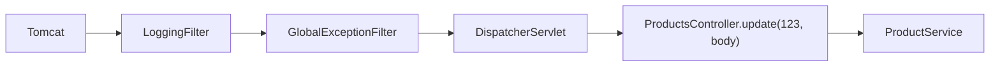

# Rutarea în mvc_java_store_app

Un router minimal, scris de mână, ca să se vadă ce face un framework MVC (de exemplu Spring) în spatele adnotărilor. Nu folosește DI container, adnotări de rutare, `Class.forName` sau component scanning.

Codul este în `framework/DispatcherServlet.java` și `framework/RequestParams.java`, iar legăturile se fac în `Main.java`.

## Cum circulă un request

Exemplu: `PUT /products/123` cu un body JSON.



1. **Tomcat** primește request-ul. Singurul servlet este `DispatcherServlet`, mapat pe `/*`.
2. **Filtrele.** `LoggingFilter` măsoară durata. `GlobalExceptionFilter` prinde excepțiile și le transformă în răspunsuri JSON (400, 404, 405, 503, 500).
3. **Cheia și id-ul.** `DispatcherServlet` ia path-ul `products/123`. Ultimul segment e doar din cifre, deci este id-ul `123`, iar cheia este `products`. Dacă ultimul segment nu e numeric, ca în `products/abc`, face parte din cheie, iar cheia nu există, deci răspunsul este 404.
4. **Controllerul.** Dispatcher-ul caută rețeta (`Supplier`) pentru cheie și creează controllerul cu `computeIfAbsent`, doar la primul request. După aceea folosește aceeași instanță.
5. **Numele metodei.** Verbul și prezența id-ului dau numele metodei din tabelul de mai jos: `PUT {id}` → `update`. Dacă metoda nu există în controller, răspunsul este 405.
6. **Argumentele,** alese după tipul fiecărui parametru:
   - `int` primește id-ul, validat: doar cifre, cel mult 9, mai mare decât 0. Altfel răspunsul este 400.
   - `RequestParams` primește query string-ul.
   - orice alt tip primește body-ul JSON, de exemplu `ProductWriteRequest`.
7. **Apelul.** `Method.invoke(controller, 123, body)` rulează metoda. Dacă metoda aruncă o excepție, dispatcher-ul o despachetează din `InvocationTargetException`, ca filtrul să vadă excepția originală, de exemplu `ProductNotFoundException` → 404.
8. **Răspunsul.** Obiectul întors devine JSON, cu status 200, sau 201 pentru POST.

## Convenția verb → metodă

| Request | Metoda din controller | Status |
|---|---|---|
| `GET /products` | `getAll(RequestParams)` | 200 |
| `GET /products/{id}` | `getOne(int)` | 200 |
| `POST /products` | `create(body)` | 201 |
| `PUT /products/{id}` | `update(int, body)` | 200 |
| `PATCH /products/{id}` | `patch(int, body)` | 200 |
| `DELETE /products/{id}` | `delete(int)` | 200 |

Orice altă combinație, de exemplu `POST /products/1`, `DELETE /products` sau `HEAD`, dă 405. La fel și o metodă care lipsește din controller: `MobileProductsController` are doar `getAll`.

## Cum adaugi o resursă nouă

Exemplu: `/categories`.

1. Scrii controllerul ca pe o clasă obișnuită, fără `HttpServlet` și fără request sau response. Pui doar metodele de care ai nevoie, cu numele din convenție:

   ```java
   public class CategoriesController {
       private final CategoryService categoryService;

       public CategoriesController(CategoryService categoryService) {
           this.categoryService = categoryService;
       }

       public List<Category> getAll(RequestParams params) {
           return categoryService.getAll();
       }

       public Category getOne(int id) {
           return categoryService.getById(id);
       }
   }
   ```

2. În `Main` înregistrezi rețeta:

   ```java
   dispatcherServlet.register("categories", () -> new CategoriesController(categoryService));
   ```

Dispatcher-ul nu se modifică.

## Corespondența cu Spring

| Aici | În Spring |
|---|---|
| `DispatcherServlet`, singurul servlet, pe `/*` | `DispatcherServlet` |
| `register(key, Supplier)`: rețeta după care se construiește controllerul | bean definition |
| `instances` + `computeIfAbsent`: o singură instanță, creată lazy | bean singleton, cu `@Lazy` |
| construirea manuală a dependențelor în `Main` | containerul IoC (`ApplicationContext`) |
| convenția de nume (`GET {id}` → `getOne`) | `@GetMapping("/{id}")`, `@PostMapping` și celelalte |
| `findMethod` + `METHOD_NAMES` | `HandlerMapping` |
| `Method.invoke(controller, arguments)` | `HandlerAdapter` |
| alegerea argumentelor după tip | `HandlerMethodArgumentResolver` (`@PathVariable`, `@RequestParam`, `@RequestBody`) |
| `jsonMapper.writeValueAsString(result)` | `HttpMessageConverter` (`@ResponseBody`) |
| `GlobalExceptionFilter` | `@ControllerAdvice` + `@ExceptionHandler` |

## Class definition și class instance

- **Class definition** este descrierea clasei: `ProductsController.class`, un obiect `Class<?>` încărcat o singură dată de JVM. Conține numele clasei, metodele, parametrii și adnotările, dar nu are date proprii. Reflection lucrează pe ea: `getMethods()` găsește `getOne`, `isAnnotationPresent(Log.class)` vede `@Log`.
- **Class instance** este un obiect concret, creat cu `new ProductsController(productService)`. Are propriul `productService` și doar pe ea poți apela o metodă: `method.invoke(instance, 123)`.

În router, `Supplier`-ul spune cum se face o instanță, dar nu o face încă. `computeIfAbsent` o face o singură dată, la primul request, și o păstrează în `instances`. `controller.getClass()` duce de la instanță înapoi la definiție, ca dispatcher-ul să-i poată căuta metodele.
